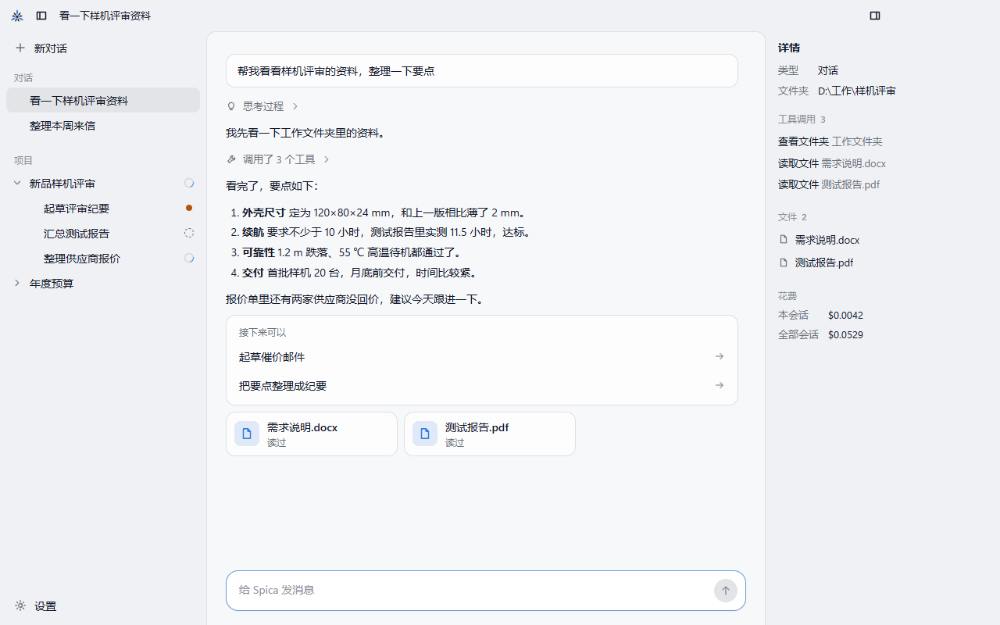
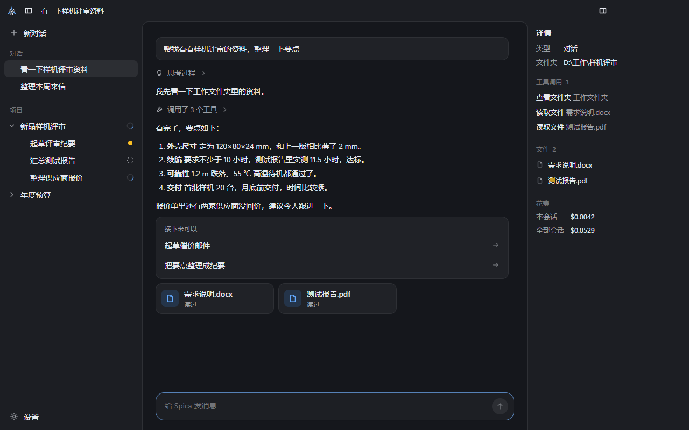
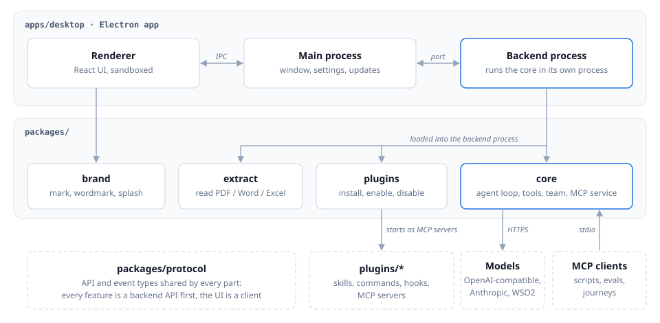

<p align="center">
  <picture>
    <source media="(prefers-color-scheme: dark)" srcset="apps/desktop/resources/branding/svg/spica-banner-dark.svg">
    
  </picture>
</p>

<p align="center">
  An open-source desktop agent workbench for Windows: your own small team of AI agents
  that keeps multi-stage work moving.
</p>

<p align="center">
  
  
</p>

## What it is

Spica is built for people who work with outside parties and push work through internal
stages, not for developers only. It gives you a personal team:

- a **top-level agent** that knows every project and can start new ones,
- a **project-manager agent** per project, bound to the project's folder,
- **sub-agents** the manager opens for separate tasks. You can step into any of them and
  change direction; the manager sees what you said and decided there.

Around that team:

- **API first.** Every feature is a backend API; the window is one client of it and
  Spica's own MCP service is another, so scripts and evaluations drive the same agents.
- **Files.** Agents read PDF, Word and Excel files and answer with file cards.
- **Mail.** Incoming mail can be sorted into projects; the project's manager suggests what
  to do next. Irreversible actions (sending mail, writing to other systems) ask first.
- **Plugins.** Skills, commands, MCP servers and code hooks in one folder; disabling a
  plugin withdraws everything it registered.
- **Models.** Any OpenAI-compatible endpoint (including LiteLLM proxies), the Anthropic
  API, or a WSO2 API gateway. Spica can be set up to run entirely inside a private
  network.
- **Locked-down PCs.** Installs per user without administrator rights, depends on nothing
  preinstalled, and never pops up a console window.

## Quick start

Requirements: Windows 10 or 11 and Node.js 24. No administrator rights needed.

```sh
git clone https://github.com/KanbaraKenji/SPiCa.git
cd SPiCa
npm install
npm run dev
```

The first `npm run dev` downloads the Electron runtime (about 100 MB) once. When the
window opens, add a model under **Settings › Models** (设置 › 模型; the interface is in
Chinese for now).

To install a built version instead, download `Spica-Setup-<version>.exe` (per-user
installer) or `Spica-Portable-<version>.exe` from the
[Releases](https://github.com/KanbaraKenji/SPiCa/releases) page.

## Architecture

<p align="center">
  
</p>

- `apps/desktop` is the Electron app. The agent core runs in its own backend process, so a
  crash there never takes the window down.
- `packages/core` is the agent core: the agent loop, built-in tools, the three-level team,
  model providers and Spica's MCP service. It has no runtime dependencies beyond Node.
- `packages/extract` reads documents, `packages/plugins` installs and runs plugins,
  `packages/brand` draws the mark and the splash, and `packages/protocol` holds the API
  and event types every part shares.
- `plugins/` holds the official plugins: `example-notes` and `outlook-mail`.

Design documents are in Chinese; start at [docs/README.md](docs/README.md).

## Scripts

| Command | What it does |
| --- | --- |
| `npm run dev` | Start the desktop app in development mode |
| `npm run build` | Build the desktop app bundles |
| `npm run dist` | Build the per-user installer and the portable exe into `apps/desktop/release/` |
| `npm run lint` | ESLint over the whole repository |
| `npm run typecheck` | TypeScript type check for every workspace |
| `npm test` | Unit and integration tests (Vitest, fake model gateway, no keys needed) |
| `npm run scan:sensitive` | Scan the repository for sensitive words |
| `npm run acceptance` | Run the automated acceptance journeys and write a summary |
| `npm run release:prepare -- <version>` | Set the version, commit and tag a release (does not push) |

## Acceptance journeys

The first release is judged by eight user journeys. J2–J7 run automatically through
Spica's MCP service with a real model; J8 is a screenshot matrix; J1 is checked by hand.

| Journey | What is checked | How to run |
| --- | --- | --- |
| J1 Install and start | Installs without admin rights, splash plays, first reply streams | By hand, with `npm run dist` |
| J2 Read files | The top-level agent answers from PDF / Word / Excel files, with file cards | `npm run journeys` |
| J3 Create a project | A project with a manager, two sub-agents in parallel, then a summary | `npm run journeys` |
| J4 Step in | You change direction inside a sub-agent; the manager's summary reflects it | `npm run journeys` |
| J5 Ask and confirm | A question card, then a confirmation before an irreversible action | `npm run journeys` |
| J6 Plugins | Install a plugin, its tools work at once, disable it and they are gone | `npm run journey:j6` |
| J7 Recover | Close or kill the app mid-run; conversations, projects and sub-agents survive | `npm run journeys` |
| J8 Looks | Light and dark, four window sizes, 100% and 150% zoom | `npm run shots` |

`npm run acceptance` runs all three commands in turn and saves a summary to
`out/acceptance/`; `npm run acceptance -- --only j6,shots` runs some of them.

The model journeys need a `.env.local` at the repository root (copy `.env.example`): an
OpenAI-compatible endpoint, key and model. A full run costs a few cents.
`npm run shots` rewrites the images in `docs/screenshots/shell/`.

## Writing a plugin

A plugin is a folder with a `manifest.json` and any of skills, commands, MCP servers,
hooks and views. Start with the [plugin author guide](docs/plugins/authoring.md) (in
Chinese) and the working example in [plugins/example-notes](plugins/example-notes).

## Known issues

- On Windows with the system Node 24.15, aborting a streaming HTTP request occasionally
  crashes the process natively (exit code `0xC0000409`) during tests or smoke runs — not
  an assertion failure, a rerun passes; the core avoids it by cancelling the reader
  instead of aborting the connection when the user stops, and the Node bundled with the
  Spica desktop app (Electron 45, Node 24.22.2) does not reproduce it (see
  [docs/design/agent-core.md](docs/design/agent-core.md) §20). CI retries the test step
  once for this reason.

## Contributing

See [CONTRIBUTING.md](CONTRIBUTING.md).

## License

Apache License 2.0. See [LICENSE](LICENSE) and [NOTICE](NOTICE).
